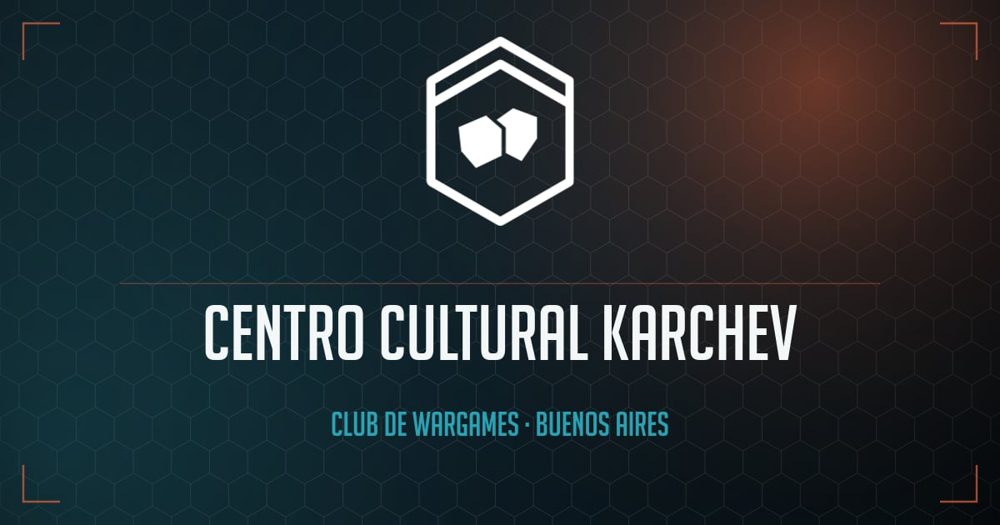

  

<strong>Club de wargames y juegos de mesa en Buenos Aires, desde 2016.</strong>

Nos juntamos a jugar: skirmish, mass battle, post-apoc, fantasy y mesa. Un club hecho
entre todos, donde cada uno aporta lo que puede. Si venís sin nada, te prestamos; si
querés aprender un sistema nuevo, alguien te enseña.

Esta organización es donde vive el software del club: la web y las herramientas que
hacemos para nuestros juegos (constructores de listas, generadores y demás), abiertas
para que cualquiera las use o las mejore.

## Herramientas y proyectos

| Proyecto                                                            | Qué es                                                                                                                |
| :------------------------------------------------------------------ | :-------------------------------------------------------------------------------------------------------------------- |
| [`cckarchev-web`](https://github.com/cckarchev/cckarchev-web)       | La web del club — [cckarchev.ar](https://www.cckarchev.ar)                                                            |
| [`gb-meat-grinder`](https://github.com/cckarchev/gb-meat-grinder)   | Herramienta de Guild Ball — [gbmeatgrinder.netlify.app](https://gbmeatgrinder.netlify.app/)                           |
| [`wmr-list-builder`](https://github.com/cckarchev/wmr-list-builder) | Constructor de listas de Warmaster Revolution — [wmr-list-builder.netlify.app](https://wmr-list-builder.netlify.app/) |
| [`cck-tools`](https://github.com/cckarchev/cck-tools)               | Herramientas del club: generador de cartas de Greathelm y de mapas de Warmaster — [cckarchev.github.io/cck-tools](https://cckarchev.github.io/cck-tools/) |

## Dónde encontrarnos

Noche de club todos los **martes 19:00 → 00:00**, y jornada larga el **tercer sábado del
mes**. Estamos en Flores, Buenos Aires.

- 🌐 [cckarchev.ar](https://www.cckarchev.ar)
- 📸 Instagram: [@cckarchev](https://www.instagram.com/cckarchev/)
- 👍 Facebook: [/cckarchev](https://www.facebook.com/cckarchev)
- 💬 [Discord](https://discord.gg/ecaXCW6Fwf)
- ✉️ cckarchev@gmail.com

---

Proyectos no oficiales, sin afiliación ni respaldo de Games Workshop, Steamforged
Games ni de los demás titulares de marca. Todos los nombres y términos asociados son
marcas de sus respectivos dueños y se usan sin permiso, para uso de fans, sin fines
comerciales.
